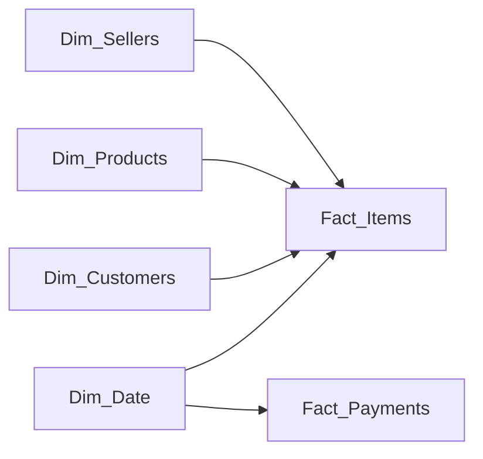

# Olist E-Commerce Analytics Dashboard (Power BI)

An end-to-end Power BI project built on 100K+ real Brazilian e-commerce orders. It covers data cleaning in Power Query, a star-schema data model, DAX measures, and a 2-page dashboard that answers one central question:

> **Where is the business growing, and how much is delivery performance hurting customer satisfaction?**


---

## Table of Contents
1. [Business Problem](#1-business-problem)
2. [Key Findings at a Glance](#2-key-findings-at-a-glance)
3. [Dataset](#3-dataset)
4. [Tools and Skills](#4-tools-and-skills)
5. [Data Cleaning (Power Query)](#5-data-cleaning-power-query)
6. [Data Model](#6-data-model)
7. [DAX Measures and Calculations](#7-dax-measures-and-calculations)
8. [Dashboard Walkthrough](#8-dashboard-walkthrough)
9. [Business Insights and Recommendations](#9-business-insights-and-recommendations)
10. [Assumptions and Limitations](#10-assumptions-and-limitations)
11. [Repository Structure and How to Run](#11-repository-structure-and-how-to-run)

---

## 1. Business Problem

Olist is a Brazilian marketplace that connects small sellers to customers. A leadership team would want to know:

| # | Question | Dashboard page |
|---|----------|----------------|
| 1 | How is revenue growing, and when does it peak? | Business Overview |
| 2 | Which product categories drive revenue? | Business Overview |
| 3 | Is the business too dependent on one region? | Business Overview |
| 4 | Are customers coming back? | Business Overview |
| 5 | How reliable is delivery, and where is it worst? | Delivery and Satisfaction |
| 6 | Does late delivery hurt customer reviews? | Delivery and Satisfaction |
| 7 | Is delivery performance improving over time? | Delivery and Satisfaction |

---

## 2. Key Findings at a Glance

| Metric | Value |
|--------|-------|
| Total revenue (delivered orders) | **R$13.18M** |
| Total orders | **96,203** |
| Average order value | **R$137** |
| Unique customers | **~93K** |
| Late delivery rate | **8.13%** |
| Average delivery time | **~12 days** |
| Average review score | **4.08 / 5** |

- **Late deliveries cut the average review from about 4.2 to about 2.5.**
- **About 97% of customers order only once.** Retention is the biggest weakness.
- **São Paulo alone is about 38% of revenue**, and the top 3 states are about 63%.
- **2018 (Jan to Aug) revenue of R$7.2M has already passed all of 2017 (R$6.0M).**
- **Late rates are highest in the north-east** (Alagoas about 24%, Maranhão about 20%).

---

## 3. Dataset

**Source:** [Brazilian E-Commerce Public Dataset by Olist](https://www.kaggle.com/datasets/olistbr/brazilian-ecommerce) (Kaggle). Check the Kaggle page for the license and usage terms. The raw data is not included in this repository.

| File | Used for |
|------|----------|
| `olist_orders_dataset.csv` | Order status, purchase and delivery dates |
| `olist_order_items_dataset.csv` | Price, freight, product and seller per item (main fact table) |
| `olist_customers_dataset.csv` | Customer ID, unique customer ID, state |
| `olist_products_dataset.csv` | Product to category link |
| `product_category_name_translation.csv` | Portuguese to English category names |
| `olist_order_reviews_dataset.csv` | Review scores |
| `olist_order_payments_dataset.csv` | Payment type and value (loaded into the model) |
| `olist_sellers_dataset.csv` | Seller location (loaded into the model) |
| `olist_geolocation_dataset.csv` | **Not used** (about 1M rows with many entries per zip code; state-level analysis is enough) |

---

## 4. Tools and Skills

**Tools:** Power BI Desktop, Power Query (M), DAX

**Skills demonstrated**
- Data cleaning and transformation with Power Query
- Star-schema modelling and relationship design
- DAX measures and calculated columns (distinct counts, conditional aggregation, `CALCULATE`, `ALL`, `SWITCH`)
- Custom date table and date hierarchy
- Dashboard design: layout, theming, slicer interaction control
- Turning data into business insights and recommendations

---

## 5. Data Cleaning (Power Query)

| Table | What I did and why |
|-------|--------------------|
| **Orders** | Kept `delivered` orders only. Kept purchases between **2017-01-01 and 2018-08-31**, because 2016 and Sep to Oct 2018 are nearly empty and would distort trends. Removed rows with no delivery date. Created `delivery_days` and `is_late`. |
| **Order Items** | Removed unused columns, set correct data types (decimal for price and freight, text for IDs). Became the main fact table. |
| **Reviews** | 551 orders had more than one review. Grouped by `order_id` and averaged the score so each order has **one** review row. Without this, merging would duplicate order items and inflate revenue. |
| **Products** | Merged with the translation table to get English category names. **610 products had no category** and became `Unknown`. Two categories had no translation and were mapped manually. |
| **Customers** | Dropped the zip code column (it loses leading zeros when read as a number). Kept `customer_unique_id`, because `customer_id` is generated per order and cannot identify repeat customers. |
| **Payments** | Removed `not_defined` payment types and the sequence column. Merged the purchase date from Orders so it connects to the date table. |
| **Geolocation** | Excluded for performance. |

### Key Power Query steps

**Delivery metrics (in Orders):**
```m
// Full days between purchase and delivery
delivery_days = Duration.Days([order_delivered_customer_date] - [order_purchase_timestamp])

// 1 if delivered after the estimated date, otherwise 0
is_late = if [order_delivered_customer_date] > [order_estimated_delivery_date] then 1 else 0
```

**One review row per order (in Reviews):**
```m
= Table.Group(Source, {"order_id"},
    {{"review_score", each List.Average([review_score]), type number}})
```

**Clean category name (in Products):**
```m
category =
    if [product_category_name_english] <> null then [product_category_name_english]
    else if [product_category_name] = "pc_gamer" then "pc_gamer"
    else if [product_category_name] = "portateis_cozinha_e_preparadores_de_alimentos" then "portable_kitchen_appliances"
    else "Unknown"
```

### Building the main fact table
`Fact_Items` is the order items table with three merges added:

| Merge | Join type | Columns added |
|-------|-----------|---------------|
| Orders | **Inner** (drops items from cancelled or out-of-range orders) | `customer_id`, `purchase_date`, `delivery_days`, `is_late` |
| Reviews | Left outer | `review_score` |
| Customers | Left outer | `customer_unique_id` |

**Validation:** after the merges, `Fact_Items` had 109,872 rows covering 96,203 distinct orders, and total revenue matched an independent check in Python (R$13.18M). The helper tables (raw Orders, Reviews, Category Translation) have **Enable load** switched off, so the model stays light.

---

## 6. Data Model

A star schema with `Fact_Items` at the centre. Every relationship is one-to-many with single-direction filtering.



| From (one) | To (many) |
|------------|-----------|
| `Dim_Date[Date]` | `Fact_Items[purchase_date]` |
| `Dim_Date[Date]` | `Fact_Payments[purchase_date]` |
| `Dim_Customers[customer_id]` | `Fact_Items[customer_id]` |
| `Dim_Products[product_id]` | `Fact_Items[product_id]` |
| `Dim_Sellers[seller_id]` | `Fact_Items[seller_id]` |

`Customer Type` is a small **disconnected helper table** (`One-time`, `Repeat`) that powers the customer donut chart.


---

## 7. DAX Measures and Calculations

### Date table
- A custom **calendar table** covering Jan 2017 to Aug 2018, built with `CALENDAR` and `ADDCOLUMNS`.
- Added Year, Month Number, Month Name and Year-Month columns, and marked it as the model's date table.
- `Month` is sorted by month number, and a **Month Start** date column is used on the time-series chart so months always appear in the correct order.

### Calculated columns (Fact_Items)
| Column | Purpose | Functions used |
|--------|---------|----------------|
| Delivery Status | Labels each order **Late** or **On Time** | `IF` |
| Delivery Bucket | Groups delivery time into 0-7, 8-14, 15-21, 22-30 and 30+ days | `SWITCH`, `TRUE` |
| Bucket Order | Numeric order so the buckets sort correctly | `SWITCH`, sort-by-column |

### Measures
| Measure | What it calculates | Functions used |
|---------|-------------------|----------------|
| Total Revenue | Sum of item prices | `SUM` |
| Total Orders | Number of distinct orders | `DISTINCTCOUNT` |
| AOV | Average order value (revenue per order) | `DIVIDE` |
| Unique Customers | Distinct real customers (by unique customer ID) | `DISTINCTCOUNT` |
| Avg Delivery Days | Average full days from purchase to delivery | `AVERAGE` |
| Avg Review | Average review score | `AVERAGE` |
| Late % | Share of orders delivered after the estimated date | `CALCULATE`, `DISTINCTCOUNT`, `DIVIDE` |
| Repeat Customers | Customers with more than one order | `COUNTROWS`, `FILTER`, `VALUES`, `CALCULATE` |
| Repeat Customer % | Repeat customers as a share of all customers | `DIVIDE` |
| Customers by Type | Splits customers into One-time and Repeat for the donut chart (uses a disconnected helper table) | `SWITCH`, `SELECTEDVALUE` |
| Revenue % of Total | Each state's share of total business revenue | `CALCULATE`, `ALL`, `DIVIDE` |

**Design note:** `ALL` is used for the revenue share so the percentage is relative to the whole business, not just the top 10 states shown in the chart (using `ALLSELECTED` there gives inflated percentages).

---

## 8. Dashboard Walkthrough

### Page 1: Business Overview


| Visual | Question it answers | Fields |
|--------|--------------------|--------|
| KPI cards | How big is the business? | Total Revenue, Total Orders, AOV, Unique Customers |
| Line chart: Monthly Revenue 2017 vs 2018 | How is revenue growing, and when does it peak? | `Month`, `Total Revenue`, `Year` as legend |
| Bar chart: Top 10 Categories by Revenue | Which categories drive revenue? | `category`, `Total Revenue`, Top N filter by revenue |
| Bar chart: Top 10 States by Share of Revenue | Is revenue concentrated in one region? | `customer_state`, `Revenue % of Total` (São Paulo highlighted) |
| Donut: One-time vs Repeat Customers | Are customers coming back? | `Customer Type`, `Customers by Type` |
| Slicers: Year, State | Filter the whole page | `Dim_Date[Year]`, `customer_state` |

### Page 2: Delivery and Satisfaction


| Visual | Question it answers | Fields |
|--------|--------------------|--------|
| KPI cards | How reliable is delivery overall? | Late %, Avg Delivery Days, Avg Review |
| Column: Avg Review, On Time vs Late | Does late delivery hurt reviews? | `Delivery Status`, `Avg Review` |
| Column: Avg Review by Delivery Time | How does the review change as delivery gets slower? | `Delivery Bucket`, `Avg Review` |
| Line: Late Delivery % Over Time | Is delivery improving or getting worse? | `Month Start`, `Late %` |
| Bar: Top 10 States by Late % | Where is delivery worst? | `customer_state`, `Late %` (filtered to states with 100 or more orders) |

**Interaction design:** the State slicer is set to *not* filter the state charts, and the Year slicer does not filter the 2017 vs 2018 line chart. Otherwise those charts would collapse to a single bar or line. This is configured through Edit Interactions.

### Interactive filtering example
Every visual responds to the Year and State slicers. Here the dashboard is filtered to **São Paulo in 2017**: revenue is R$2.14M, the late rate is only **4.65%** (against 8.13% nationally) and average delivery time is **8.85 days** (against about 12 nationally). Late orders in São Paulo still score much lower on reviews (2.7 vs 4.3 for on-time orders).


---

## 9. Business Insights and Recommendations

### 1. Growth is strong, and peaks around Black Friday
2018 (Jan to Aug) revenue of **R$7.2M** has already passed the whole of 2017 (**R$6.0M**), and November 2017 is the highest month of the 2017 line.
**Recommendation:** plan inventory, seller capacity and delivery staffing ahead of November every year.

### 2. Revenue is spread across categories, but heavily concentrated by region
The top 5 categories (Health and Beauty, Watches and Gifts, Bed Bath Table, Sports and Leisure, Computers and Accessories) make up about 40% of revenue, and no single category is dominant. **Geography is different:** São Paulo is about **38%** of revenue, and the top 3 states (SP, RJ, MG) are about **63%**.
**Recommendation:** run targeted growth campaigns in the mid-sized states (RS, PR, SC, BA) to reduce dependence on the south-east.

### 3. Late delivery is strongly linked to poor reviews
Orders delivered on time average about **4.2** stars, while late orders average about **2.5**. The review score also falls steadily as delivery time grows, from about 4.3 for orders delivered in 0 to 7 days to about 2.2 for orders taking more than 30 days.
**Recommendation:** treat delivery as the main driver of satisfaction. Set more realistic delivery estimates, and proactively message customers whose orders are running late.

### 4. Delivery problems are regional and seasonal
Overall, 8.13% of orders arrive late, but the north-east is much worse (Alagoas about 24%, Maranhão about 20%). Late rates also spike in **November 2017** (the Black Friday revenue peak) and again in **Feb to Mar 2018**, when about 1 in 5 orders arrived late. Rio de Janeiro combines a large share of revenue (about 13%) with a late rate well above average, so it is the best place to improve delivery first.
**Recommendation:** add regional fulfilment partners in the north-east, prioritise Rio de Janeiro, and add capacity before peak periods such as November.

### 5. Retention is the biggest untapped opportunity
Only about **3%** of customers placed a second order, so growth depends almost entirely on acquiring new customers, which is expensive.
**Recommendation:** launch post-purchase follow-ups, loyalty offers and category-based recommendations. Even a small increase in repeat rate would add meaningful revenue.

---

## 10. Assumptions and Limitations

- **Only delivered orders** with a delivery date are included. Cancelled or unavailable orders are excluded.
- **Period:** Jan 2017 to Aug 2018. 2018 has 8 months, so use the same months for year-over-year comparisons.
- `Avg Review` and `Avg Delivery Days` are calculated at the **order-item level**, so orders with several items are weighted more heavily.
- `delivery_days` counts **full days elapsed**; `is_late` compares the exact delivery time with the estimated time.
- **Repeat customer rate** is calculated within the selected period, so it looks lower when a single year is selected.
- The link between late delivery and low reviews is a strong **association**, not proof of causation.
- The dataset is from a Brazilian marketplace and values are in Brazilian reais (R$).

---

## 11. Repository Structure and How to Run

```
olist-powerbi-dashboard/
├── README.md
├── Olist_Dashboard.pbix
└── screenshots/
    ├── 1_overview.png
    ├── 2_delivery.png
    ├── 3_data_model.png
    ├── 4_overview_2017.png
    └── 5_delivery_2017.png
```

**To open the project**
1. Download the dataset from Kaggle and unzip the CSV files into one folder.
2. Open `Olist_Dashboard.pbix` in Power BI Desktop.
3. If prompted, go to **Transform data → Data source settings** and point each query to your local CSV folder.
4. Click **Refresh**.
